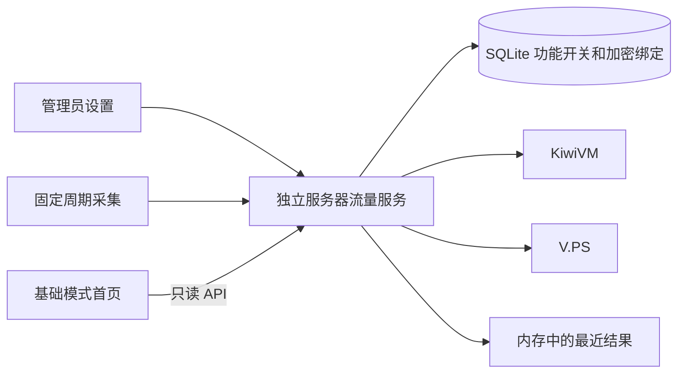

# Design7 — 基础模式服务器剩余流量

> v1.1，2026-11-23。基础模式过渡功能的设计记录，待构建。凭据在站内配置并加密存入 SQLite，单容器自动采集，配置文件导入后重新绑定。工程约束见 [AGENTS.md](AGENTS.md)，上游实测见 [研究平台流量 API 展示方案](thread://01a20893-014a-7541-81f9-fb1fef1875a6?hostId=local)。

## 一、范围和启用规则

基础模式首页向所有启用的登录用户展示同一份 VPS 剩余流量。首版固定搬瓦工（KiwiVM）和 V.PS（xTom），每家最多绑定一个实例。站内原有「流量」卡及 `traffic_card_enabled` 继续负责用户配额，两者各自展示。

| 条件 | 自动采集 | 首页 |
| --- | --- | --- |
| 首次安装、升级或成功导入配置 | 总开关默认关闭 | 隐藏 |
| 总开关关闭 | 停止发起新请求，保留两家绑定及各自开关 | 隐藏 |
| 总开关打开，处于基础模式，至少有一家已绑定并启用 | 开启后安排首轮，再每 15 分钟采集 | 每个符合条件的平台显示一行 |
| 总开关打开，但两家均未启用或未绑定 | 等待管理员绑定及启用 | 隐藏 |
| 高级模式、Setup 或应急态 | 暂停采集 | 隐藏 |

固定平台、顺序、接口、显示单位、采集周期和请求超时直接写在独立模块中。管理员通过 UI 输入实例 ID、API Key 和 Refresh Token。首版以两行文字为限，分别显示两家余量。

## 二、上游接口与计量

| 平台 | 请求 | 数据规则 |
| --- | --- | --- |
| 搬瓦工 | `POST https://api.64clouds.com/v1/getServiceInfo`，表单字段 `veid`、`api_key`。 | HTTP `200` 且业务字段 `error=0` 才算成功。首版支持 `monthly_data_multiplier=1`，余量为 `max(0, plan_monthly_data - data_counter) / 2^30`，显示 `GiB`。研究中与面板对账为 `180.41 GiB`。倍率缺失、异常或非 1 时提示「计费倍率待核对」。 |
| V.PS | `POST https://vps.hosting/api/token`，JSON 请求体只提交 `refresh_token`。随后用 Bearer Access Token 调 `GET https://vps.hosting/api/service/{id}/resources`。 | 直接取 `limit.data_combined` 为余量，显示面板口径 `GB`。同一实例的余量与上游配额之差已与面板双向流量对账，研究也验证了仅用 Refresh Token 续期后读取余量。 |

两家均按小数点后两位展示，区分数值为零和字段缺失。搬瓦工套餐配额须为正，已用量和 V.PS 余量须为非负有限数值。解析器只读取相关字段，非法或非预期数据直接提示「服务商返回的流量数据无法读取」。V.PS 无需推算字节或重置日期。搬瓦工非 1 倍率待有官方证据或面板样本时再增加对应计算。 [搬瓦工官方 API 说明入口](https://bandwagonhost.com/dubai-vps.php) · [V.PS Resources](https://vps.hosting/userapi/#tag/services/GET/service/%7Bid%7D/resources) · [V.PS 计量说明](https://v.ps/faq/)

## 三、管理员设置

入口为「后台管理 → 面板配置 → 运行与安全 → 服务器剩余流量」。沿用现有设置卡片、响应式布局和未保存提示。高级模式只显示「仅在基础模式下可用」。总开关独立保存，关闭时仍可维护各家绑定。单家开关可暂停该平台并保留凭据，便于其中一家尚未接通时先启用另一家。

```text
服务器剩余流量
[ 开关 ] 启用服务器剩余流量      [保存]
开启后自动采集，基础模式的登录用户可在首页查看。

搬瓦工 (KiwiVM)    [ 开关 ] 采集此实例
VEID               [                     ]
API Key            [                     ]  已保存
[保存]  [立即采集]  [解除绑定]

V.PS               [ 开关 ] 采集此实例
Service ID         [                     ]
Refresh Token      [                     ]  未配置
[保存]  [立即采集]  [解除绑定]
```

- 搬瓦工管理员在目标 VPS 的 KiwiVM API 页面取得 `VEID` 和实例 API Key。该 Key 具备实例管理能力，采集模块只调用 `getServiceInfo`。V.PS 管理员在官方 API 页完成登录及可能的 MFA，复制登录响应中的 `refresh`，通过官方服务列表核对 `service.id`。项目只接收实例 ID 和 Refresh Token。 [V.PS 登录](https://vps.hosting/userapi/#tag/clientarea/POST/login) · [MFA](https://vps.hosting/userapi/#tag/clientarea/POST/mfa/verify) · [服务列表](https://vps.hosting/userapi/#tag/services/GET/service)
- 实例 ID 为正十进制数字字符串。凭据输入框掩码显示，读取设置只返回保存标记，保存成功后清空输入框。同一实例可留空保留凭据，首次绑定或更换实例 ID 必须填写新凭据。保存只提交本地配置。功能和平台均启用时，保存新绑定后安排该平台采集。
- 「立即采集」只用已保存且已启用的绑定，等待本次请求完成后在本卡片显示数值或错误。若同平台正在采集，提示「正在采集，请稍后再试」。解除绑定经确认后清除该平台的本地配置和展示结果。总开关关闭时禁用「立即采集」。

## 四、首页与错误展示

在顶部摘要区下方、订阅平台列表上方放置「服务器剩余流量」卡片。桌面每家一行，窄屏允许采集时间换行。首页进入时独立读取本地结果，停留时每分钟再读一次，离页清理定时器。打开首页不会请求服务商。

```text
服务器剩余流量
搬瓦工   剩余 180.41 GiB · 采集于 11-23 22:15
V.PS     采集失败 · 无法连接服务商
```

每个平台只保留最近一次采集结果。尚未完成首次采集显示「等待采集」，成功显示数值及时间，失败直接显示简短原因并撤下先前数值。下一轮成功后恢复显示数值。一家的失败不会遮掉另一家的结果。首页接口自身失败时，在该区域显示「服务器余量读取失败」，首页其他请求独立完成。管理员在设置页看到同一错误及必要的操作提示。

## 五、独立后端与最小接口



### 5.1 模块与数据

- 新建 `backend/internal/providertraffic`，包含两个固定客户端、绑定读写、一个定时循环及内存结果。独立 handler 由 `server.New` 注入，接入正常服务的生命周期。启动和退出使用服务器上下文。Setup、应急态和高级模式由实际服务端状态判定。
- 追加 `0002_provider_traffic.sql`。用一张独立的 `provider_traffic_settings` 单行表存总开关、两家的绑定开关、实例 ID、密文及绑定修订号。无记录视为总开关关闭。改绑或换证分配新的、不可复用的绑定修订号，解绑清除修订号。开关与自动续期沿用当前绑定修订号。业务凭据复用 `config.EncryptWithTx` 与配套的 AES-GCM 解密能力。
- 最近一次结果和 V.PS Access Token 放在模块内存，进程重启后由启动采集恢复。先前成功值、采集历史和上游原始响应均无需持久化。首页只取当前允许展示且与绑定修订一致的结果。共用状态只需读取 Setup 和基础模式，现有首页汇总、用户配额、订阅、规则、Xray 数据不承载这项集成。

### 5.2 站内接口

| 接口 | 守卫与行为 |
| --- | --- |
| `GET /api/home/provider-traffic` | 现有会话校验。返回 `list`、`total`。每条含平台标识和 `waiting`、`ok` 或 `error`。成功附余量、单位、UTC 采集时间，失败附面向用户的短文案。关闭或不适用时返回空列表。 |
| `GET /api/admin/settings/provider-traffic` | 会话及管理员校验。返回总开关、两家开关、实例 ID、绑定修订、凭据保存标记和最近结果。高级模式只返回不可用状态。 |
| `PUT /api/admin/settings/provider-traffic` | 管理员，限基础模式。只保存总开关。 |
| `PUT /api/admin/settings/provider-traffic/:provider` | 管理员，限基础模式。保存单家开关与绑定，提交实例 ID、已有绑定修订及可选的替换凭据。 |
| `POST /api/admin/settings/provider-traffic/:provider/refresh` | 管理员，限基础模式且两级开关均已开启。对已保存绑定采集一次，直接返回结果。 |
| `DELETE /api/admin/settings/provider-traffic/:provider` | 管理员，限基础模式。按当前绑定修订解除绑定。 |

沿用现有响应包裹及参数、权限、冲突状态码。响应使用 `Cache-Control: no-store`。上游失败写入该平台的 `error` 结果，避免把上游鉴权错误触发成站内退出登录。首页响应不含实例 ID、绑定修订或凭据。示例为一台成功、一台失败。

```json
{
  "code": 0,
  "data": {
    "list": [
      { "provider": "kiwivm", "status": "ok", "remaining": 180.41, "unit": "GiB", "sampled_at": "2026-11-23T14:15:00Z" },
      { "provider": "vps", "status": "error", "message": "无法连接服务商" }
    ],
    "total": 2
  }
}
```

### 5.3 采集、Token 轮换和失败处理

1. 正常服务启动时采集一次已启用的绑定，此后每 15 分钟执行。开启总开关、保存新的已启用绑定或重新启用平台时发出一次后台触发。高级模式切回基础模式后最迟下一轮继续采集。手动与自动采集复用同一入口，每个平台同时最多一个请求链。某家失败直接记录结果，继续处理另一家。
2. V.PS 在 Access Token 不可用或到期时，用已保存 Refresh Token 换取一对新 Token。先对当前绑定修订加密提交新 Refresh Token，再用新 Access Token 请求余量。Access Token 只用于本站内存缓存，用响应 JWT 的到期时间安排下次刷新。无法取得到期时间时仅供本轮使用。采集开始后若关闭功能或切换模式，已收到的新 Refresh Token 仍可为同一绑定提交，随后不再发起资源查询或发布结果。在途采集写回须匹配当前绑定修订，避免改绑、导入或清空后写回旧凭据。 [V.PS 续期接口](https://vps.hosting/userapi/#tag/clientarea/POST/token)
3. 失败直接显示本次结果，等待下一个固定周期或管理员手动采集。明确拒绝凭据时提示重新填写。Cloudflare `403`、超时和网络错误提示「无法连接服务商」，上游限流直接提示「服务商限流」。Access Token 被拒绝时清掉缓存，下次采集再续期。续期成功但本地保存失败时终止本轮，提示「续期结果未保存，可能需要重新绑定」。首版用这些结果覆盖常见失败。
4. 出站采用固定 HTTPS 主机、路径和方法，禁止重定向，单次请求超时 8 秒，响应体最多读取 256 KiB。真实 Key、Token、账号信息、原始响应和错误链不进入响应、页面或日志。管理员可看到受控原因，例如「凭据被拒绝」「实例不可用」「计费倍率待核对」。日志只记录平台、失败阶段和安全的错误类别。

## 六、导入、备份与完整移除

| 操作 | 设计 |
| --- | --- |
| 配置导出 | 现有导出读取 `system_config` 和既有专项数据。功能开关和绑定位于独立表，均不进入配置文件。 |
| 配置导入 | v1/v2 的配置覆盖事务内清除功能表，提交后回到关闭且未绑定。事务失败保留原设置。导入确认提示需重新绑定。 |
| 整库备份 | 按现有数据库快照恢复开关和加密绑定，首次结果由自动采集生成。若 V.PS 的备份 Token 已被轮换，按实际错误重新绑定。将备份恢复为另一站点时，启用前先停用源站对应采集，避免两个实例轮换同一凭据。 |
| 一键清空或应急重新初始化 | 复用共用清表事务清除该表。应急路径读到迁移前的数据库时允许本表尚不存在。已在途的任务不能重建绑定。 |
| 后期完整移除 | 先通过总开关停止采集。后续构建移除独立前端组件/API、后端模块及服务装配，撤掉配置导入和清空事务里的功能表清理入口，追加前向迁移删除功能表，保留迁移历史。已有备份继续按备份原有生命周期保存。 |

代码接入集中在 [HomeView.vue](frontend/src/views/HomeView.vue)、[SettingsView.vue](frontend/src/views/admin/SettingsView.vue)、[server.go](backend/internal/server/server.go)，以及 [export.go](backend/internal/config/export.go) 的两条配置导入事务和 [dataclear.go](backend/internal/dataclear/dataclear.go) 的共用清库入口。现有签名密钥导出问题继续由 [ExportRelated1.md](ExportRelated1.md) 跟踪。

## 七、构建验收

| 检查 | 预期 |
| --- | --- |
| 开关和访问 | 新安装、升级及导入后默认关闭。关闭时无新上游请求，首页隐藏。管理员开启后自动采集，普通用户只能读首页结果。高级模式、Setup 和应急态无采集。 |
| 两家协议 | 以 mock 验证真实零余量、KiwiVM HTTP `200` 的业务失败、非 1 倍率、V.PS 轮换先入库、网关 `403`，以及一次失败直接显示错误、后续成功恢复。 |
| 凭据和删除 | 检查加密入库、读响应与日志无凭据。验证配置导入回滚、全量清空、运行中改绑或关闭以及整库备份恢复。检查功能表和模块可按第六节移除。 |
| 浏览器 | 验证单家、双家、首轮等待、直接错误和窄屏。确认首页其他功能可独立工作。 |
| 实际出网 | 从目标容器完成搬瓦工查询和面板对账，并用 V.PS 做一次「续期 → 入库 → 查询资源」。此前真实 V.PS 续期在浏览器成功，本机命令行无凭据探测遇到 Cloudflare `403`。若目标容器仍被拦截，V.PS 保持停用，搬瓦工可以先启用。 |

后续构建按 [AGENTS.md](AGENTS.md) 执行 Go build、vet、test、相关并发测试和前端构建，再使用独立数据目录检查容器和出网。

## 八、变更记录

| 版本 | 日期 | 记录 |
| --- | --- | --- |
| v1.0 | 2026-11-23 | 确认站内配置、SQLite 加密、单容器采集以及配置文件不迁移绑定。 |
| v1.1 | 2026-11-23 | 明确为可完整移除的过渡功能。增加默认关闭的总开关，固定两家接口和周期，改用内存中的最近一次结果，失败直接提示原因，补全卸载路径。 |
